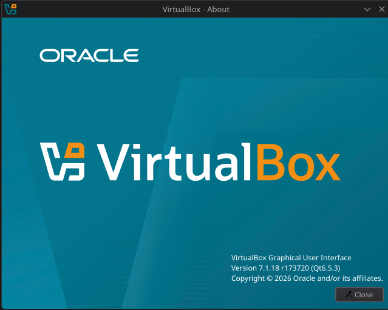
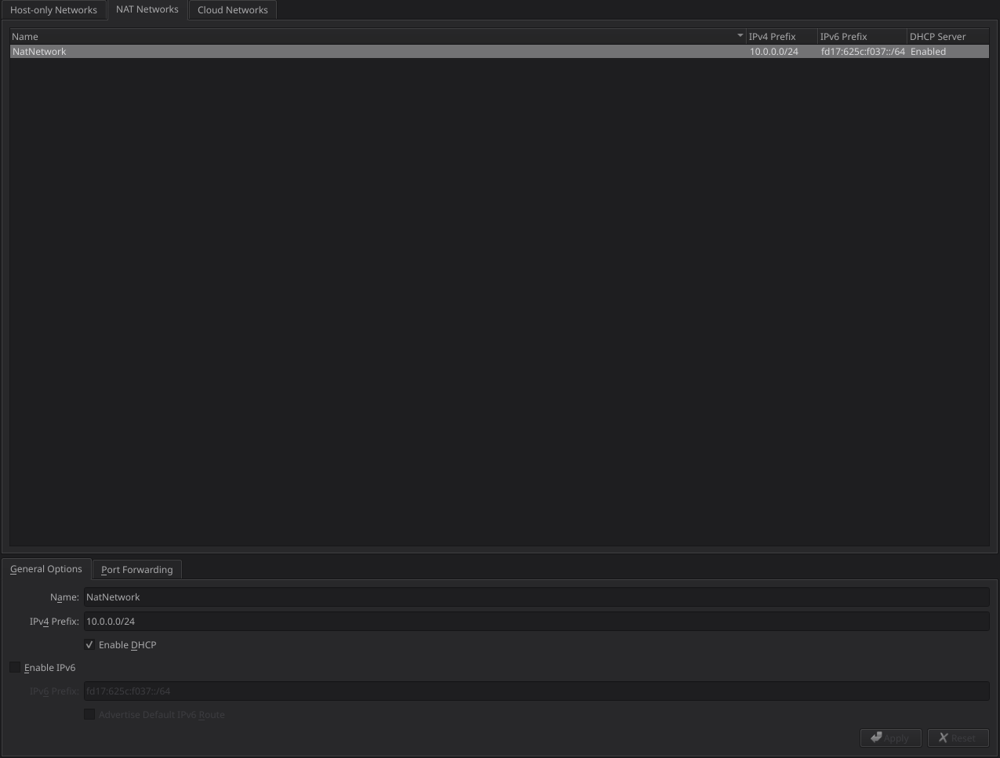
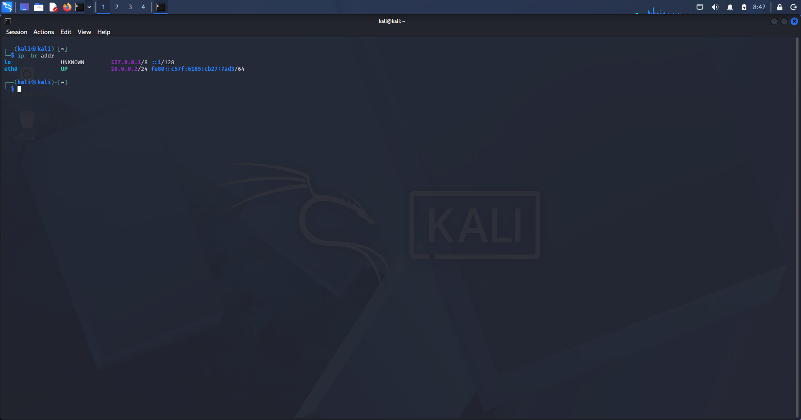
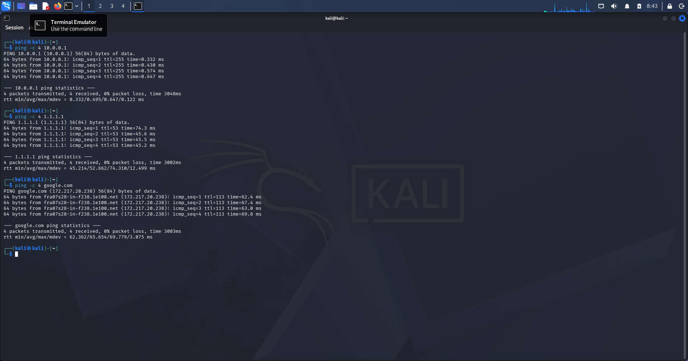
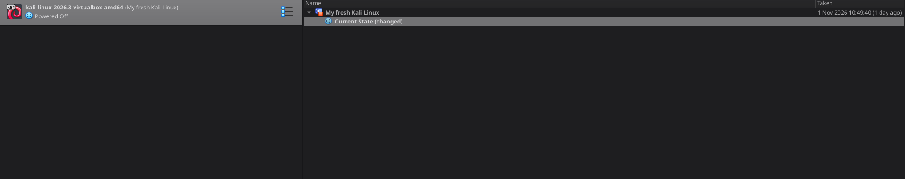

# Week 1 -- Project Module 1: Practical Cybersecurity Lab Environment Setup

> **Internship:** Networkwalks -- Cybersecurity Internship\
> **Module:** Week 1 \| Project Module 1 (WK1-PM1)\
> **Status:** Completed
> **Author:** Abdesslam Mouffok
> **Date:** 01/11/2026

## 1. Overview

This project documents the setup of a virtual cybersecurity practice
environment using **Oracle VirtualBox** and **Kali Linux**.

The goal of the lab is to prepare a virtual machine that can be used for
authorized cybersecurity learning, practical exercises, and future lab
challenges.

This documentation follows the requirements in the Week 1 Project Module
1 task sheet. Update the status and add your own screenshots and
observations so that this README accurately reflects what you personally
configured and tested.

## 2. Lab objectives

-   Install and use Oracle VirtualBox as the virtualization platform.
-   Import Kali Linux as a virtual machine.
-   Create a VirtualBox NAT Network using the `10.0.0.0/24` subnet.
-   Configure the Kali Linux VM with the specified address:
    `10.0.0.2/24`.
-   Enable internet access for the Kali Linux VM.
-   Enable clipboard and drag-and-drop functionality in the VM settings.
-   Share the host's `/downloads` folder with the virtual machine.
-   Take a VM snapshot as a restore point.

## 3. Environment and requirements

The task sheet recommends the following host specifications (these are
recommendations, not strict minimum requirements):

  Component                 Recommendation / requirement
  ------------------------- -----------------------------------------
  Host operating system     Windows 11 is shown in the task diagram
  RAM                       8 GB or more recommended
  Storage                   256 GB SSD or more recommended
  Processor                 Intel Core i3/i5 or similar
  Virtualization platform   Latest version of Oracle VirtualBox
  Guest operating system    Latest Kali Linux VM
  Virtual network           NAT Network
  Network subnet            `10.0.0.0/24`
  Kali Linux address        `10.0.0.2/24`
  Shared host folder        `/downloads`

**My actual host specifications:**
- Operating system: Kali Linux (host)
- CPU: 11th Gen Intel Core i5-1145G7 @ 2.60GHz
- RAM: 15 GiB
- Storage: 221 GB total, 84 GB available
- VirtualBox: 7.1.18r173720

**Software versions used:** 
- Oracle VirtualBox: 7.1.18r173720
- Kali Linux: Kali GNU/Linux Rolling 2026.3

## 4. Network design

The lab uses a VirtualBox NAT Network so the Kali Linux VM can access
the internet while operating in a virtualized network environment.

  Setting                             Value
  ----------------------------------- ----------------------
  Network mode                        NAT Network
  Network address                     `10.0.0.0/24`
  Kali Linux IP address               `10.0.0.2/24`
  Address range shown in task sheet   `10.0.0.2–10.0.0.99`

The task sheet's diagram shows the host computer connected to the
VirtualBox NAT Network and Kali Linux running as a guest VM.

> The task sheet does not specify a default gateway as a fixed
> requirement. Its troubleshooting guidance says to try `10.0.0.1` if
> internet connectivity problems occur.

### Network diagram


``` text
+----------------------------+
|        Host Computer       |
|        Kali Linux          |
+-------------+--------------+
              |
              | VirtualBox
              |
+-------------v--------------+
|       NAT Network          |
|       10.0.0.0/24          |
+-------------+--------------+
              |
              |
+-------------v--------------+
|      Kali Linux VM         |
|      10.0.0.2/24           |
+----------------------------+
```

## 5. Setup procedure

Record what you actually did in each step. Add screenshots where
indicated.

### Step 1 -- Prepare the host

1.  Check that the host computer meets the available hardware
    requirements.
2.  Install 7-Zip if needed for extracting downloaded files.
3.  Download and install Oracle VirtualBox.

**Evidence:** 



### Step 2 -- Create the NAT Network

1.  Open VirtualBox network settings.
2.  Create a NAT Network.
3.  Configure the network using the `10.0.0.0/24` subnet.
4.  Save the network configuration.

**Evidence:** 



### Step 3 -- Import Kali Linux

1.  Download the Kali Linux virtual machine from the official Kali
    website.
2.  Import the VM into VirtualBox.
3.  Review the VM settings before starting it.

**Evidence:** 



### Step 4 -- Configure the Kali Linux VM

1.  Attach the VM to the created NAT Network.
2.  Configure the Kali Linux network interface with the task's specified
    address, `10.0.0.2/24`.
3.  Enable clipboard and drag-and-drop in the VM settings.
4.  Configure the shared host folder as required by the task sheet
    (`/downloads`).
5.  Check that the VM has internet access.

**Evidence:** 



### Step 5 -- Create a VM snapshot

1.  Shut down or prepare the VM as appropriate.
2.  Use VirtualBox's snapshot feature to create a restore point.
3.  Give the snapshot a clear name, such as
    `Week 1 - Initial Kali Setup`.

**Evidence:** 



## 6. Verification checklist

Only mark an item as complete after you have personally checked it.

-   [X] Oracle VirtualBox installed.
-   [X] Kali Linux VM imported and starts successfully.
-   [X] NAT Network created with the `10.0.0.0/24` subnet.
-   [X] Kali Linux configured with `10.0.0.2/24`.
-   [X] Kali Linux internet connectivity tested.
-   [X] Clipboard sharing enabled.
-   [X] Drag-and-drop enabled.
-   [X] Host `/downloads` folder shared with the VM.
-   [X] VM snapshot created.

### Test results

  -----------------------------------------------------------------------
  Test                    Expected result         My result
  ----------------------- ----------------------- -----------------------
  VM startup              Kali Linux boots        \[Pass\]

  IP configuration        Kali uses `10.0.0.2/24` \[Pass\]

  Internet access         Kali can reach the      \[Pass\]

  Clipboard /             Configured features     \[Pass\]

  Shared folder           Shared folder is        \[Pass\]

  Snapshot                Snapshot is visible in  \[Pass\]
  -----------------------------------------------------------------------

## 7. Troubleshooting

The task sheet recommends checking the following if Kali Linux has no
internet connection:

1.  Confirm that the NAT Network was created correctly.
2.  Check the VirtualBox network settings for the Kali VM.
3.  Confirm that another VM on the same NAT Network is not already using
    `10.0.0.2`.
4.  Restart the virtual machine, VirtualBox, and, if necessary, the host
    computer.
5.  If the internet connection still has issues, the task sheet suggests
    trying `10.0.0.1` where applicable.

For VirtualBox 7 with Kali Linux 2026.1 or newer, the task sheet
provides these commands as a possible connectivity fix:

``` bash
sudo nmcli connection modify "Wired connection 1" ipv4.dad-timeout 0
sudo nmcli connection down "Wired connection 1"
sudo nmcli connection up "Wired connection 1"
```


## 9. Learning outcomes

-What I learned: I learned how to configure a Kali Linux virtual machine in VirtualBox, create a NAT Network, assign and verify a static IP address, and test network connectivity.

-What I found challenging: Configuring the shared folder between the host and Kali Linux guest, especially making it accessible at the required /downloads path.

-How I solved a problem: I configured the VirtualBox shared folder, mounted it inside Kali Linux, and tested file sharing by creating a file in the guest and reading it from the host.

-What I want to explore next: I want to learn more about VirtualBox networking, Linux administration, and how to build a safe cybersecurity lab for practical exercises.


## 10. References

-   Networkwalks, **Week 1 \| Project Module 1 -- Practical Lab
    Environment Setup** (internship task sheet).
-   [Oracle VirtualBox
    Downloads](https://www.virtualbox.org/wiki/Downloads)
-   [Kali Linux -- Get Kali](https://www.kali.org/get-kali/)
-   [7-Zip Downloads](https://www.7-zip.org/download.html)

